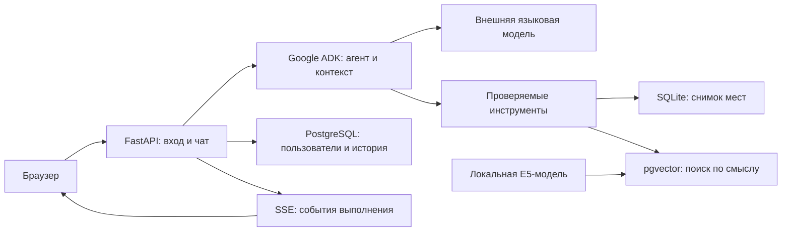

# Рядом — агент по местам Ростова-на-Дону

Учебный проект курса «Агентный ИИ» MMCS и локальный веб-MVP: вопросы обычным
текстом, поиск мест, история диалога и регистрация пользователей.
Данные — снимок OpenStreetMap: 8860 объектов. Поиск ресторанов по смыслу
использует названия и теги кухни; наличие блюда в меню не подтверждается.

| Приложение | Назначение | Технологии |
|---|---|---|
| [Учебный агент](week2/practice/README.md) | Пять инструментов, собственный цикл, 10×3 задач, A/B описаний и разбор ошибок | Python, OpenAI-совместимый API, SQLite |
| [Веб-приложение](week2/practice/mvp/README.md) | Чат, авторизация, контекст, события выполнения и семантический поиск | Google ADK, FastAPI, PostgreSQL, pgvector, Docker |

## Быстрый запуск сайта

Нужны Docker Desktop с Linux containers и Docker Compose 2.30+.
Для однократной подготовки нужны Python 3.12 и менеджер пакетов uv.
Команды ниже выполняются из корня клонированного репозитория в PowerShell.

```powershell
cd week2/practice/mvp
uv run --locked python -m app.cli prepare
```

Создайте локальный `.env` по [.env.example](week2/practice/mvp/.env.example).
Самостоятельно укажите `OPENAI_API_KEY`, `OPENAI_BASE_URL` и `MODEL`.
Пример провайдера — OpenRouter; идентификатор модели берите из своего
доступного набора. Шаблон не содержит действующего ключа.

После настройки запуск выполняется одной командой:

```powershell
docker compose up --build -d --wait
```

Откройте [localhost:8000](http://localhost:8000), зарегистрируйтесь и задайте
вопрос, например «Найди заведения, похожие на пельменную».
Первый запуск загружает зависимости и локальную модель векторизации.
Состояние подготовки индекса видно в интерфейсе; готовность веб-сервиса
ещё не означает готовность семантического индекса.

Подробные команды и тесты — в [инструкции MVP](week2/practice/mvp/README.md).

## Архитектура



SSE (Server-Sent Events) передаёт шаги, вызовы инструментов и результаты;
приватные рассуждения модели не выводятся. История изолирована по пользователям.
Пароли хешируются Argon2id, изменения защищены CSRF. Одновременно выполняются
до трёх запросов; допускаются пять пользователей в работе и очереди,
по одному незавершённому запросу на пользователя.

Сайт рассчитан на один локальный компьютер и один процесс приложения.
Публичное размещение с HTTPS, восстановление пароля и масштабирование на
несколько серверов в MVP не реализованы. Ответы внешней модели могут меняться.

## Учебное задание и результаты

- [Исходное задание](week2/assignment.md).
- [Запуск агента и экспериментов](week2/practice/README.md).
- [Отчёт с метриками и тремя разборами ошибок](week2/practice/report.md).

В зафиксированном A/B эксперименте оба варианта описаний получили 30/30
успешных попыток и 30/30 правильных первых вызовов. Полные описания потребовали
на 23% больше токенов. Это результат небольшого набора, а не гарантия качества
на других вопросах. Расход учитывается в токенах.

## Конфигурация и данные

Действующие ключи, локальные настройки, данные пользователей, пароли БД,
скачанные веса, рабочие отчёты и промежуточные журналы исключены из Git.
Случайный пароль PostgreSQL создаёт команда подготовки; его не требуется
вводить или читать вручную. Приложение передаёт вопросы и необходимый
контекст выбранному провайдеру модели.

В репозитории сохранены публичный снимок OSM, готовая SQLite-база,
код и небольшие журналы, подтверждающие учебные результаты.
Тесты используют подмены внешней модели. Команды реальных экспериментов
обращаются к провайдеру и расходуют доступную квоту.

## Лицензия

Собственные дополнения проекта — [MIT](LICENSE). Сторонние материалы сохраняют
свои условия: данные OpenStreetMap — ODbL 1.0; учебная обвязка, зависимости
и модели не получают новую лицензию автоматически.
Подробности — [THIRD_PARTY_NOTICES.md](THIRD_PARTY_NOTICES.md).
